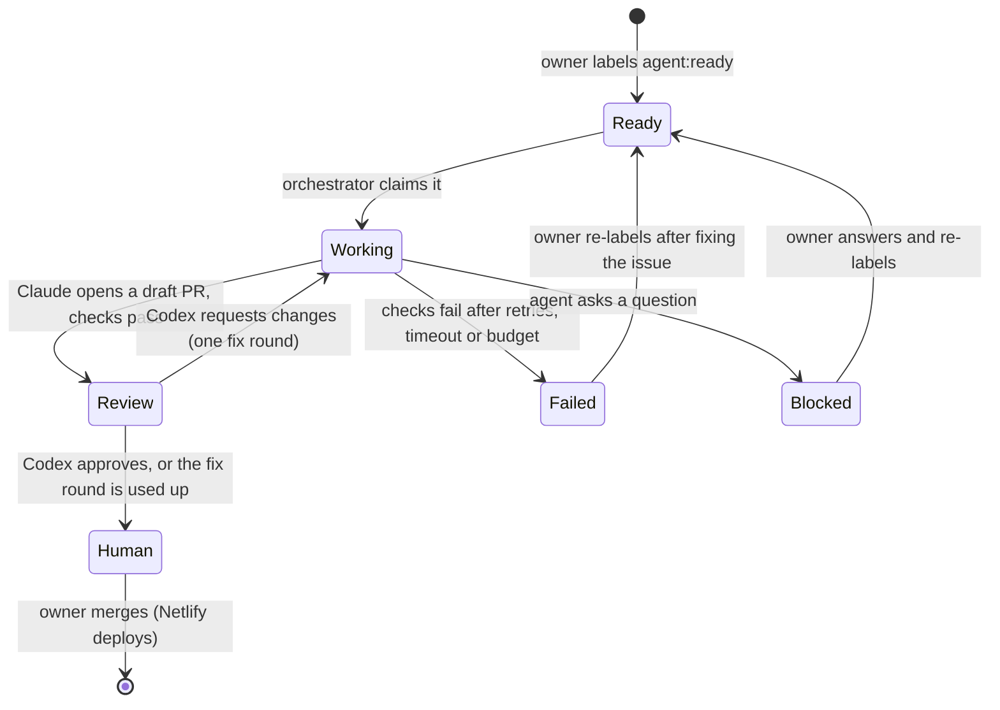

# Agent architecture

A small orchestrator on the owner's server picks up approved GitHub issues, has Claude Code implement each one in its own workspace, has Codex review the result, and leaves a draft pull request for a person to merge. GitHub holds all the state, so nothing is lost if the server restarts. No framework: one script, one config file, a timer.

Status: **design**. Nothing here runs yet. Setup steps are in [dell-setup.md](dell-setup.md).

## Roles

| Part | Job | Never does |
| --- | --- | --- |
| Owner | Writes or approves issues, applies `agent:ready`, reviews and merges PRs, runs migrations | — |
| Clinical reviewer | Signs off medical content (`needs-clinical-review`) | — |
| Orchestrator (Dell) | Finds ready issues, makes workspaces, runs agents and checks, enforces limits, records everything | Merge, deploy, read production secrets |
| Claude Code | Implements the task on a branch, opens a draft PR | Merge, push to `main` |
| Codex | Reviews the PR on its own, runs the checks, comments with findings | Push code to the branch (review only) |
| GitHub Actions | `site-checks.yml` on every PR | — |
| Netlify | Deploy preview per PR; production on merge | — |

Planning (turning an idea into a good issue) can happen in any chat assistant. It is not part of the automated loop, so it adds no running cost.

## The flow



State lives in issue labels, so the orchestrator can always rebuild it from GitHub:

| Label | Meaning | Set by |
| --- | --- | --- |
| `agent:ready` | Approved for an agent | Owner only (the orchestrator checks who applied it) |
| `agent:working` | Claimed; a run is in progress | Orchestrator |
| `agent:review` | Draft PR open, Codex reviewing | Orchestrator |
| `agent:human` | Ready for the owner | Orchestrator |
| `agent:blocked` | The agent asked a question on the issue | Orchestrator |
| `agent:failed` | Gave up; reason in a comment | Orchestrator |
| `needs-clinical-review` | Medical content; a clinician must sign off | Agent or owner |

### One run, step by step

1. **Pick.** Every 10 minutes a timer lists open issues labeled `agent:ready` in each configured repository, oldest first. It skips any whose label wasn't applied by the owner.
2. **Claim.** It swaps the label to `agent:working` and comments "Started run <id>".
3. **Workspace.** It makes a fresh git worktree at `~/agents/work/<repo>/<issue>`, on branch `agent/<issue>-<slug>`, from the latest `main`.
4. **Implement.** It runs Claude Code headless in that folder with the issue text, AGENTS.md and a turn limit. Claude makes the change, runs the checks and writes the PR description.
5. **Check.** The orchestrator runs the repository's check commands itself and doesn't trust the agent's report. If they fail, Claude gets one retry with the failure output.
6. **Open.** It pushes the branch and opens a **draft** PR with `Closes #<issue>`, then labels the issue `agent:review`.
7. **Review.** Codex runs in a separate, clean worktree of the PR branch with a review-only prompt: does the change do what the issue asked, does it break a CLAUDE.md rule, does it touch a protected path, do the checks pass? It posts its findings as a PR comment.
8. **Fix once.** If Codex requests changes, Claude gets one fix round with the review comment. Codex reviews again. No more rounds after that.
9. **Hand off.** The orchestrator labels the issue `agent:human`, marks the PR ready for review and comments a summary: cost, time, checks, Codex's verdict and the deploy preview link.
10. **Clean up.** It deletes the worktree after the PR is merged or closed, or after 14 days.

## Workspaces

- Each task gets its own `git worktree`, so tasks never share files and a broken run can't affect another.
- Agents run as a dedicated Linux user (`agent`) with no `sudo`, and with no access to the owner's files or browser sessions.
- At most **one task per repository** and **two at once** overall (16 GB of RAM, and Netlify builds per push).
- Optional later: run each task in a container for stronger isolation. Start without it, since the worktree, the unprivileged user and the checks cover the main risks at a fraction of the complexity.

## Limits, logging, spending and recovery

| Control | Default | Why |
| --- | --- | --- |
| Attempts per issue | 2 (the first run + 1 retry on failed checks) | Stops loops |
| Codex fix rounds | 1 | Keeps the agents from arguing in circles |
| Time per run | 45 minutes | A stuck run is cut off |
| Claude turns per run | 60 | Bounds cost per task |
| Daily spending cap | $10 across all repositories | Stops a runaway day; the orchestrator pauses until the next day |
| Monthly spending cap | $100 | The owner raises it deliberately |

**Spending.** If Claude Code and Codex run on flat-rate subscriptions, the caps are mostly about rate limits; if they run on API keys, the caps are real money. Either way the orchestrator records the cost each headless run reports (Claude Code's JSON output includes a cost field; check the installed version) and stops starting runs at the cap. Agents use their **own** API key, never the content agents' `ANTHROPIC_API_KEY`.

**Logging.** Every run writes one JSON-lines file, `~/agents/logs/<date>/<repo>-<issue>-<run>.jsonl`: start, each step, check output, cost, result. Logs stay on the server and are kept for 90 days. The issue and PR get only short status comments, because the repository is public. Never log environment variables or tokens.

**Recovery.** On start, the orchestrator looks for issues labeled `agent:working` with no live run (the server rebooted, or the run crashed). If attempts remain, it retries from a fresh worktree; otherwise it marks the issue `agent:failed` with the reason. Each step is safe to repeat: it reuses the branch and PR if they already exist instead of opening duplicates.

**Alerts.** One email or phone notification per failure, plus a daily summary (runs, costs, PRs waiting), sent through the same Resend path as `notify.py`.

## Security boundaries

- **GitHub access:** a fine-grained token (later a GitHub App) limited to the listed repositories, with Contents, Pull requests and Issues set to read and write. No Administration, no Secrets, no Workflows permission, so agents can't change automations, and CODEOWNERS makes a person review `.github/`.
- **Branch protection on `main`:** require a pull request with one approval from the owner, block force pushes, and let only the digest bot bypass.
- **No production secrets on the server for agents:** no Supabase secret key, no database password, no Netlify or Instagram tokens. Agents test against previews and public APIs only.
- **Untrusted text:** issue and comment text from anyone but the owner is passed to agents marked as untrusted data, never as instructions.
- **The server:** no inbound ports open; remote access through Tailscale; automatic security updates; full-disk encryption.
- **Medical content:** PRs labeled `needs-clinical-review` are never marked ready until a named clinician has approved them on GitHub.

## Several repositories

One config file on the server, `~/agents/repos.yml`, lists each repository with its check commands and limits:

```yaml
repos:
  - name: DrZaff/ai-medicine-collective
    checks:
      - python scripts/checks/site_check.py
      - python scripts/blog_agent/build_index.py
      - node scripts/checks/browser_smoke.mjs
    max_parallel: 1
  - name: DrZaff/junglecards
    checks: [npm test --prefix backend]
    max_parallel: 1
```

Each repository needs an AGENTS.md (or CLAUDE.md) and working check commands before it's added. JungleCards (already has tests), Little Log (iOS: checks need a Mac, so review-only at first), MedSpanish AI and the workout app join one at a time.

## Mission Control (later)

A read-only dashboard, reachable only over Tailscale, that answers "what are my agents doing and what do they need from me?":

- **Queue:** per repository, issues by state (ready, working, review, waiting for you, failed).
- **Runs:** the last 50 runs, with duration, cost, checks, Codex verdict, and links to the PR and preview.
- **Waiting for you:** PRs ready to merge, questions from blocked agents, clinical reviews outstanding.
- **Spending:** today, this month, per repository, against the caps.
- **Health:** last orchestrator heartbeat, disk space, failures in the last 24 hours.

Version 1 is a static page the orchestrator regenerates after each run from GitHub and the log files, so there's no database and nothing new to secure. Approvals stay on GitHub, where they're recorded and protected. Write actions (pause, retry, raise a cap) come later, behind sign-in.
