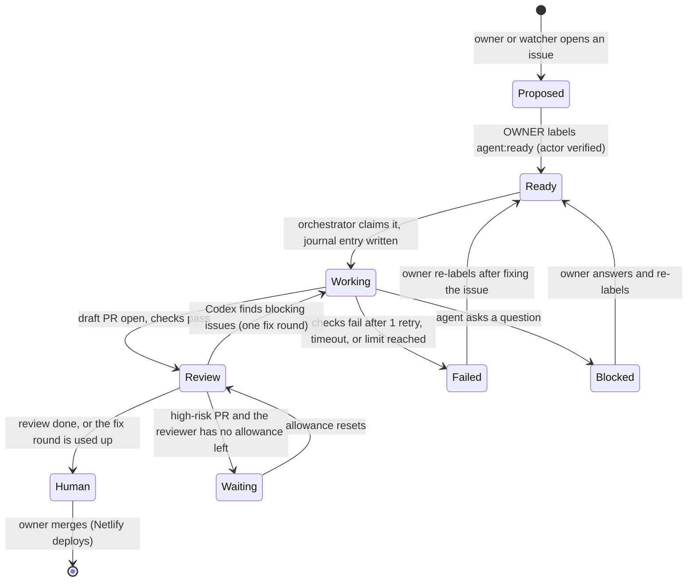

# Agent architecture

Approved GitHub issues become draft pull requests: Claude Code implements each one in a throwaway container, Codex reviews it independently, and the owner merges. GitHub holds the shared state; a small trusted orchestrator on the owner's Dell schedules the work, enforces limits and keeps a local run journal. No framework: one service, one config file, a timer.

Status: **design**, revised 2026-11-06 after an outside review. Nothing here runs yet. Setup steps are in [dell-setup.md](dell-setup.md).

**Scope.** This is the agent system only ("Program A"). Moving hosting off Netlify, Supabase, Render, Neon or Firebase is a separate, later project ("Program B"). Until then every project stays on its current hosting, and agents never need production credentials.

## Step zero: try the built-in integrations first

Before writing any orchestrator code, test what Anthropic and OpenAI already provide, because every part they cover is code we don't have to own or secure:

1. **Codex reviewing pull requests on GitHub**, in OpenAI's cloud sandbox. If it reviews reliably, it replaces our reviewer plumbing and its isolation problem.
2. **Claude Code's official GitHub Action** implementing a small labeled issue on GitHub's runners.

Record for each one what it does well, what it costs (which allowance or credit it draws from), and what it can't do. The orchestrator then covers only the gaps: scheduling, limits, the run journal, notifications, and anything that has to run on the Dell.

## Roles

| Part | Job | Never does |
| --- | --- | --- |
| Owner | Approves issues, merges PRs, runs migrations, holds production secrets | — |
| Clinical reviewer | Approves medical changes on GitHub, tied to the exact commit (see "Risk tiers") | — |
| Orchestrator (Dell, trusted) | Checks who approved an issue, starts workers, issues short-lived credentials, runs checks, publishes PRs, keeps the run journal, alerts | Run repository code itself, merge, deploy |
| Worker: Claude Code (builder) | Implements one issue inside a disposable container | Hold long-lived credentials, push to `main`, reach other projects or the host |
| Worker: Codex (reviewer) | Writes a structured review report on the PR | Push code; count as the human approval |
| GitHub Actions | `site-checks.yml` on every PR | — |
| Netlify | Deploy preview per PR; production on merge | — |

## The flow

| Label | Meaning | Set by |
| --- | --- | --- |
| `agent:proposed` | Suggested by the owner or a watcher; not approved | Anyone |
| `agent:ready` | Approved for an agent | Owner only: the orchestrator reads the issue timeline and ignores the label if anyone else applied it |
| `agent:working` / `agent:review` / `agent:human` | In progress / under review / waiting for the owner | Orchestrator |
| `agent:blocked` / `agent:failed` | Agent asked a question / gave up, with the reason | Orchestrator |
| `risk:low` / `risk:medium` / `risk:high` | Sets the review depth (below) | Owner, from the issue form |
| `needs-clinical-review` | Medical content; a clinician must approve | Agent or owner |

### One run, step by step

1. **Pick.** Every 10 minutes the orchestrator lists open `agent:ready` issues, oldest first, and keeps only those labeled by the owner.
2. **Claim and record.** It writes a journal entry (below), swaps the label to `agent:working`, and comments "Started run <id>".
3. **Container.** It starts a fresh container from a fixed image, with only a clone of that repository on a new branch `agent/<issue>-<slug>`. The container has no access to the host's files, the Docker socket or other projects.
4. **Implement.** Claude Code runs headless inside it with the issue text (marked as untrusted data if anyone but the owner wrote it), AGENTS.md and a turn limit.
5. **Check.** The orchestrator runs the repository's checks itself in a second clean container, and doesn't trust the agent's report. On failure Claude gets one retry with the output.
6. **Publish.** The orchestrator, not the worker, pushes the branch and opens a **draft** PR with `Closes #<issue>`, using its own GitHub credential.
7. **Review.** Codex reviews in a separate container, or on GitHub if step zero shows that works. It posts a structured report (below).
8. **Fix once.** Blocking findings go back to Claude for one fix round, then one more review. No further rounds.
9. **Hand off.** The orchestrator labels `agent:human`, marks the PR ready, and comments a summary: time, usage, checks, the review verdict and the preview link.
10. **Clean up.** Containers are deleted when the run ends; branches after the PR closes.

### The review report

Codex writes a comment, not a GitHub approval, so no AI review can satisfy the human-approval rule. Each finding lists: **severity** (blocking / should fix / note), **file and line**, **what's wrong**, **how to reproduce it**, **confidence**, and **suggested fix**, ending with a verdict: *no blocking findings* or *changes needed*. Two models catch more than one, but they can still miss the same defect.

## Risk tiers

| Risk | Examples | Required before merge |
| --- | --- | --- |
| Low | Text, styling, docs | CI; AI review when allowance permits |
| Medium | Page behaviour, scripts, features | CI and a Codex review |
| High | Sign-in, member data, migrations, workflows, payments, medical calculations | CI, targeted tests, a Codex review (the task **waits** if the allowance is used up, never skips) and the owner's careful review |

**Clinical changes** (tool logic, scores, dosing, criteria, evidence and course text) also need:
- An approval on GitHub from the named clinician. A ruleset requires it for the clinical files and **dismisses approvals when new commits are pushed**, so the approval always covers the exact commit that ships.
- In the PR: the sources with publication dates, validation cases (normal, abnormal, boundary and invalid input), the intended users, and known limitations.
- If a tool ever becomes patient-specific diagnosis or treatment advice, a separate check of whether FDA clinical decision support or medical-device rules apply. A clinician's review alone doesn't establish that.

## Limits and usage

| Limit | Start with | Notes |
| --- | --- | --- |
| Tasks at once | 1 | Raise to 2 after 10 tasks finish cleanly |
| Queued approved tasks | 10 | More than this means the owner is approving faster than agents finish |
| Attempts per task | 1 retry after failed checks | An *attempt* is one implement-and-check cycle |
| Review rounds | 1 fix round | A *round* is one review plus one fix |
| Agent turns per attempt | 60 | A *turn* is one model step inside an attempt |
| Time per attempt | 45 min (low and medium risk), 60 min (high) | |

**Usage, not a dollar cap.** Claude Code and Codex run on the owner's plans (Claude Max, ChatGPT Plus) through the official programs, signed in by the owner. Anthropic's terms allow signing in to the unmodified Claude Code program with your own plan, but its limits assume "ordinary, individual usage", and scripted runs may draw from a separate monthly allowance. So:
- The orchestrator records the usage each run reports and stops starting runs when a plan's allowance is exhausted, resuming after the reset.
- Month one is a measurement period: real usage per task decides whether the plans are enough.
- If they aren't, or the terms don't fit this use, a separate API key with a hard monthly limit set in the provider's console covers the overflow. It's never the content bots' `ANTHROPIC_API_KEY`.

## Recovery

- **Run journal.** A small SQLite file on the Dell records each run: issue, attempt, step, container id, branch, PR number, and which side effects are done (branch pushed, PR opened, comment posted). GitHub stays the shared record; the journal makes restarts safe.
- **After a reboot or crash,** the orchestrator reads the journal, compares it with GitHub, and resumes from the last completed step without repeating side effects. If it can't tell, it marks the issue `agent:failed` with the reason and alerts the owner. It never guesses.
- **Pause switch.** One command, or one tap on the phone, stops new runs; running ones finish.
- **Reboot test** before unattended use: reboot mid-run and confirm it recovers.

## Logging and alerts

- Each run writes JSON lines to `~/agents/logs/`, kept for 90 days. Never environment variables or tokens. Issues and PRs get short status comments only, because the repositories are public.
- Phone alerts through ntfy: urgent (a run stuck, a failed reboot recovery), action needed (a PR or question waiting, batched every 2 hours), and a daily summary.
- Plain monitoring software, not AI, watches the Dell: disk, memory, the orchestrator's heartbeat.

## Security boundaries

- **Workers are untrusted.** Agents run arbitrary repository code and read text from the internet, so a worker may be manipulated. Each task gets a disposable container: unprivileged, no host files, no Docker socket, CPU and memory limits, deleted afterwards. Containers aren't a perfect boundary; a rootless container runtime or a stronger sandbox (gVisor) is preferred.
- **Outbound network is limited.** Workers can reach GitHub, the package registries and the AI providers. They can't reach the home network, other machines or arbitrary sites.
- **Credentials are split.**
  - The orchestrator holds the GitHub credential that can open PRs and comment: a fine-grained token, later a GitHub App, with Contents, Issues and Pull requests only, and no Administration, Secrets or Workflows permission.
  - Workers get at most a short-lived, read-only token for their one repository.
  - No production secrets exist on the Dell.
- **GitHub enforces the gates, not convention:**
  - A ruleset on `main` requires a pull request, passing Site checks and the owner's approval, and blocks force pushes.
  - Code-owner review is *required* by the ruleset, so CODEOWNERS on `.github/`, `supabase/` and auth code is binding.
  - Only `github-actions[bot]` may bypass, for the weekly digest. That's acceptable because agents can't edit workflows.
- **CI and previews run code too.** No `pull_request_target` workflows, no secrets in PR workflows, and previews never get production database credentials.

## Watchers

They start small, to avoid a flood of low-value issues:

| Watcher | When | How | Output |
| --- | --- | --- | --- |
| Repository health | Daily | Scripts and scanners: checks on `main`, broken links, security advisories. AI only explains unusual findings | Issues |
| Clinical content and research | Weekly | AI flags stale sources, unsupported claims and outdated evidence; a clinician decides | Issues, plus a weekly digest |

At most **2 new non-urgent issues a day**, deduplicated against open issues. The blog and living-review workflows stay the only research agents; watchers don't compete with them.

## Several repositories

`~/agents/repos.yml` on the Dell lists each repository with its check commands, container image and limits. A repository joins only when it has an AGENTS.md (or CLAUDE.md), working checks, a required CI workflow and branch protection. Order: ai-medicine-collective, then JungleCards (already has `npm test`), MedSpanish AI and the workout app, and Little Log last (iOS builds run on GitHub's macOS runners).

## Mission Control (later)

A read-only page over Tailscale, regenerated by the orchestrator after each run from GitHub and the journal. It shows the queue by state, recent runs, what's waiting for the owner, usage against each plan, and health. Approvals stay on GitHub. The pause switch is its only control at first.
