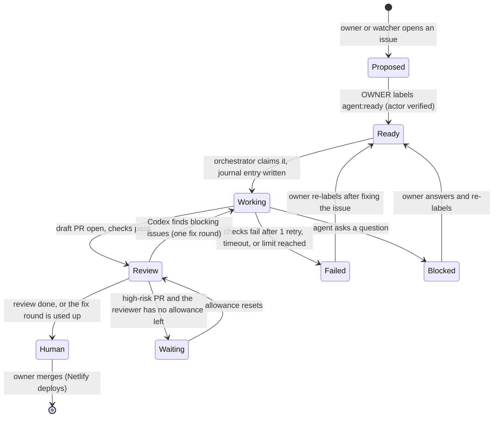

# Agent architecture

Approved GitHub issues become draft pull requests: Claude Code implements each one in a throwaway container, Codex reviews it independently, and the owner merges. GitHub holds the shared state; a small trusted orchestrator on the owner's Dell schedules the work, enforces limits and keeps a local run journal. No framework: one service, one config file, a timer.

Status: **design**, revised 2026-11-06 after an outside review. Nothing here runs yet. Setup steps are in [dell-setup.md](dell-setup.md).

**Scope.** This is the agent system only ("Program A"). Moving hosting off Netlify, Supabase, Render, Neon or Firebase is a separate, later project ("Program B"). Until then every project stays on its current hosting, and agents never need production credentials.

## Step zero: try the built-in integrations first

Before writing any orchestrator code, test what Anthropic and OpenAI already provide, because every part they cover is code we don't have to own or secure. Three small experiments, on test issues and draft PRs only:

| Experiment | Test | Passes when |
| --- | --- | --- |
| Claude Code's official GitHub Action | Implements an approved, low-risk issue | It opens a correct PR with tests, with no production access |
| Codex's GitHub pull request review | Reviews a PR with a deliberately planted defect | It finds the defect, with file and line references |
| End to end | Claude builds, Codex reviews, the owner approves | Nothing is copied between services by hand |

For each one, record:
- the permissions it needs
- which allowance or credit it uses, and how much
- how reliable it is over several runs
- whether it can start without an interactive session
- whether **Site checks run on the PRs it opens**. A PR pushed with a workflow's default `GITHUB_TOKEN` doesn't start other workflows, so an integration that opens PRs that way needs a GitHub App token instead.

**Decision rule.** If an integration passes, building or reviewing stays in the vendor's environment, and the Dell only schedules, selects tasks, tracks usage, recovers and notifies. Rule an integration out if it needs excessive permissions, can't keep the approval gates, needs credentials handled in a way the provider doesn't allow, or keeps failing representative tests. Then use the container workers below.

## Roles

| Part | Job | Never does |
| --- | --- | --- |
| Owner | Approves issues, merges PRs, runs migrations, holds production secrets | — |
| Clinical reviewer | Approves medical changes on GitHub, tied to the exact commit (see "Risk tiers") | — |
| Orchestrator (Dell, trusted) | Checks who approved an issue, starts workers, issues short-lived credentials, runs checks, publishes PRs, keeps the run journal, alerts | Run repository code itself, merge, deploy |
| Worker: Claude Code (builder) | Implements one issue inside a disposable container | Hold long-lived credentials, push to `main`, reach other projects or the host |
| Worker: Codex (reviewer) | Writes a structured review report on the PR | Push code; count as the human approval |
| GitHub Actions | `site-checks.yml` on every PR | — |
| Netlify | Deploy preview per PR; production on merge | — |

## The flow

| Label | Meaning | Set by |
| --- | --- | --- |
| `agent:proposed` | Suggested by the owner or a watcher; not approved | Anyone |
| `agent:ready` | Approved for an agent | Owner only: the orchestrator reads the issue timeline and ignores the label if anyone else applied it |
| `agent:working` / `agent:review` / `agent:human` | In progress / under review / waiting for the owner | Orchestrator |
| `agent:blocked` / `agent:failed` | Agent asked a question / gave up, with the reason | Orchestrator |
| `risk:low` / `risk:medium` / `risk:high` | Sets the review depth (below) | Owner, from the issue form |
| `needs-clinical-review` | Medical content; a clinician must approve | Agent or owner |

### One run, step by step

1. **Pick.** Every 10 minutes the orchestrator lists open `agent:ready` issues, oldest first, and keeps only those labeled by the owner.
2. **Claim and record.** It writes a journal entry (below), swaps the label to `agent:working`, and comments "Started run <id>".
3. **Container.** It starts a fresh container from a fixed image, with only a clone of that repository on a new branch `agent/<issue>-<slug>`. The container has no access to the host's files, the Docker socket or other projects.
4. **Implement.** Claude Code runs headless inside it with the issue text (marked as untrusted data if anyone but the owner wrote it), AGENTS.md, a turn limit and that run's AI credential (see "AI credentials").
5. **Check.** The orchestrator runs the repository's checks itself in a second clean container, and doesn't trust the agent's report. On failure Claude gets one retry with the output.
6. **Publish.** The orchestrator, not the worker, pushes the branch and opens a **draft** PR with `Closes #<issue>`, using its own GitHub credential.
7. **Review.** Codex reviews in a separate container, or on GitHub if step zero shows that works. It posts a structured report (below).
8. **Fix once.** Blocking findings go back to Claude for one fix round, then one more review. No further rounds.
9. **Hand off.** The orchestrator labels `agent:human`, marks the PR ready, and comments a summary: time, usage, checks, the review verdict and the preview link.
10. **Clean up.** Containers are deleted when the run ends; branches after the PR closes.

### The review report

Codex writes a comment, not a GitHub approval, so no AI review can satisfy the human-approval rule. Each finding lists: **severity** (blocking / should fix / note), **file and line**, **what's wrong**, **how to reproduce it**, **confidence**, and **suggested fix**, ending with a verdict: *no blocking findings* or *changes needed*. Two models catch more than one, but they can still miss the same defect.

## Risk tiers

**The risk on the issue form is a request, not a fact.** The orchestrator also classifies each PR from the files it changes, using a path-to-tier map in `repos.yml`. For example, `auth.js`, `supabase/`, `.github/` and payment code are high; calculators, tool logic, `evidence/` and `course-*.html` are clinical. The PR gets the **higher** of the declared and detected tiers. A PR that touches a clinical path gets `needs-clinical-review` whether or not anyone ticked the box.

| Risk | Examples | Required before merge |
| --- | --- | --- |
| Low | Text, styling, docs | CI; AI review when allowance permits |
| Medium | Page behaviour, scripts, features | CI and a Codex review |
| High | Sign-in, member data, migrations, workflows, payments, medical calculations | CI, targeted tests, a Codex review (the task **waits** if the allowance is used up, never skips) and the owner's careful review |

**Clinical changes** (tool logic, scores, dosing, criteria, evidence and course text) also need:
- An approval on GitHub from the named clinician. A ruleset requires it for the clinical files and **dismisses approvals when new commits are pushed**, so the approval always covers the exact commit that ships. The clinician checks the rendered behaviour on the deploy preview, such as calculator output for the validation cases, not only the code.
- For calculations or recommendations where a defect could change care, a second qualified clinician's approval as well.
- In the PR: the sources with publication dates, validation cases (normal, abnormal, boundary and invalid input), the intended users, and known limitations.
- If a tool ever becomes patient-specific diagnosis or treatment advice, a separate check of whether FDA clinical decision support or medical-device rules apply. A clinician's review alone doesn't establish that.

**Not enforced until configured.** These rules exist in GitHub only once CODEOWNERS (with the real clinical paths and a clinician who has repository access) and the ruleset are in place, and a negative test has shown that a clinical PR without the clinician's approval can't merge. Until then, agents take no clinical tasks.

## Limits and usage

| Limit | Start with | Notes |
| --- | --- | --- |
| Tasks at once | 1 | Raise to 2 after 10 tasks finish cleanly |
| Queued approved tasks | 10 | More than this means the owner is approving faster than agents finish |
| Attempts per task | 1 retry after failed checks | An *attempt* is one implement-and-check cycle |
| Review rounds | 1 fix round | A *round* is one review plus one fix |
| Agent turns per attempt | 60 | A *turn* is one model step inside an attempt |
| Time per attempt | 45 min (low and medium risk), 60 min (high) | |

## AI credentials: which runs use what

A worker container runs untrusted code, so **anything a worker can read, the code it runs can read too**, including an AI credential. The owner's subscription sign-ins therefore never go into a worker. The rule:

| Where the agent runs | Credential | Who holds it |
| --- | --- | --- |
| Official integrations (Claude Code's GitHub Action, Codex on GitHub or in OpenAI's cloud) | The owner's plan, connected through the vendor's own setup | The vendor; nothing on the Dell |
| The owner's own interactive sessions on the Dell or laptop | The owner's plan, signed in through the tool's own flow | The owner's account, outside every worker |
| Custom unattended workers on the Dell | A **dedicated API key per provider**, used only by workers, with a hard monthly spending limit set in the provider's console | The orchestrator, which passes it to one run's container and nothing else. It is revoked and replaced on any sign of misuse |

Why API keys for unattended workers:
- Anthropic says developers building services around Claude should use API keys, and that plan limits assume "ordinary, individual usage".
- An API key with a spending limit caps the damage from a leak at money, not the owner's account.
- It is the route both providers clearly allow.

If a provider confirms that a subscription credential is permitted for this exact pattern, it may replace the key, but it is still injected per run and never stored in an image. Consumer sign-in tokens are never copied, shared or proxied.

**Usage, measured.**
- The orchestrator records the usage and cost each run reports, and stops starting runs when an allowance or spending limit is reached.
- Month one is a measurement period: real usage per task sets the budget.
- Step zero may move most of the work onto the official integrations and the existing plans.
- OpenAI has announced changes to how ChatGPT and Codex agent allowances are shared from December 2026. Re-check Codex limits then.
- The workers' API keys are never the content bots' `ANTHROPIC_API_KEY`.

## Recovery

- **Run journal.** A small SQLite file on the Dell records each run: issue, attempt, step, container id, branch, PR number, and which side effects are done (branch pushed, PR opened, comment posted). GitHub stays the shared record; the journal makes restarts safe.
- **After a reboot or crash,** the orchestrator reads the journal, compares it with GitHub, and resumes from the last completed step without repeating side effects. If it can't tell, it marks the issue `agent:failed` with the reason and alerts the owner. It never guesses.
- **Pause switch.** One command, or one tap on the phone, stops new runs; running ones finish.
- **Reboot test** before unattended use: reboot mid-run and confirm it recovers.

## Logging and alerts

- Each run writes JSON lines to `~/agents/logs/`, kept for 90 days. Never environment variables or tokens. Issues and PRs get short status comments only, because the repositories are public.
- During the supervised pilot, GitHub's own notifications are enough. Push alerts through ntfy arrive when unattended runs begin: urgent (a run stuck, a failed reboot recovery), action needed (a PR or question waiting, batched every 2 hours), and a daily summary.
- Plain monitoring software, not AI, watches the Dell: disk, memory, the orchestrator's heartbeat.

## Security boundaries

- **Workers are untrusted.** Agents run arbitrary repository code and read text from the internet, so a worker may be manipulated. Each task gets a disposable sandbox: no host files, no Docker socket, CPU and memory limits, deleted afterwards.
- **Sandbox level:**
    - **Unattended runs require gVisor (`runsc`) or a disposable virtual machine.** Plain containers are not a strong enough boundary for arbitrary agent-run code.
    - Rootless Docker without gVisor is allowed only for supervised tests with harmless code.
    - If gVisor breaks the browser tests, a small virtual machine on the Dell hosting the workers is the fallback.
    - Memory use is tested before committing to either.
- **Outbound network is enforced, not listed.**
    - Each sandbox's only route out is an allow-list proxy. A firewall drops every other outbound packet, IPv4 and IPv6, including direct DNS.
    - Allowed: GitHub, the package registries, and the API hosts of the provider that run uses.
    - Blocked: the home network, cloud metadata addresses and everything else.
    - The setup tests run inside a sandbox and must fail to reach the router, a blocked site over IPv4 and IPv6, a blocked site through a redirect from an allowed one, and an outside DNS server.
    - Even allowed sites can carry data out, which is why workers hold no secrets beyond their capped, revocable AI key.
- **Credentials are split.**
  - The orchestrator holds the GitHub credential that can open PRs and comment: a fine-grained token, later a GitHub App, with Contents, Issues and Pull requests only, and no Administration, Secrets or Workflows permission.
  - Workers get at most a short-lived, read-only token for their one repository.
  - No production secrets exist on the Dell.
- **GitHub enforces the gates, not convention:**
  - A ruleset on `main` requires a pull request, passing Site checks and the owner's approval, and blocks force pushes.
  - Code-owner review is *required* by the ruleset, so CODEOWNERS on `.github/`, `supabase/` and auth code is binding.
  - **No broad bypass.** A ruleset bypass applies to an actor, not to one workflow, so `github-actions[bot]` must not be on the bypass list: every workflow runs as that actor. The weekly digest instead publishes through a dedicated GitHub App (for example "AMC Digest Publisher"):
    - installed on this repository only, with Contents write and nothing else
    - the only actor on the bypass list
    - its private key stored as a secret in a GitHub environment (`digest-publish`) that only `main` can deploy to, so pull request workflows can never read it
    - used only by `weekly-newsletter.yml`, which CODEOWNERS protects

    The digest's content comes only from posts already merged after human review, and an admin still previews and sends every email, so no editorial review is lost. Moving the job onto the App is its own small pull request.
- **CI and previews run code too.** No `pull_request_target` workflows, no secrets in PR workflows, and previews never get production database credentials.

## Watchers (after the pipeline works)

AI watchers start only once the build-and-review loop runs reliably; until then, CI and GitHub's dependency and security alerts cover the basics. They start small, to avoid a flood of low-value issues:

| Watcher | When | How | Output |
| --- | --- | --- | --- |
| Repository health | Daily | Scripts and scanners: checks on `main`, broken links, security advisories. AI only explains unusual findings | Issues |
| Clinical content and research | Weekly | AI flags stale sources, unsupported claims and outdated evidence; a clinician decides | Issues, plus a weekly digest |

At most **2 new non-urgent issues a day**, deduplicated against open issues. The blog and living-review workflows stay the only research agents; watchers don't compete with them.

## Several repositories

Start with ai-medicine-collective only. Later, `~/agents/repos.yml` on the Dell lists each repository with its check commands, container image, path-to-risk map and limits. A repository joins only when it has an AGENTS.md (or CLAUDE.md), working checks, a required CI workflow and branch protection. Order: ai-medicine-collective, then JungleCards (already has `npm test`), MedSpanish AI and the workout app, and Little Log last (iOS builds run on GitHub's macOS runners).

## Mission Control (later)

Not before the process works: until then, GitHub Issues and the GitHub mobile app are the dashboard. Later, a read-only page over Tailscale, regenerated by the orchestrator after each run from GitHub and the journal. It shows the queue by state, recent runs, what's waiting for the owner, usage against each plan, and health. Approvals stay on GitHub. The pause switch is its only control at first.
